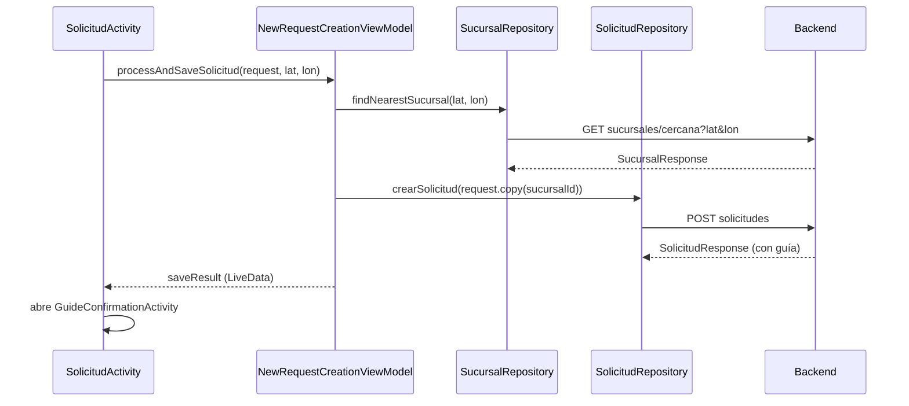

# 2. Arquitectura

## Visión de capas

```
┌─────────────────────────────────────────────────────────────┐
│ UI            ui/ (Activities)   fragment/   adapters/       │
├─────────────────────────────────────────────────────────────┤
│ Presentación  viewmodel/ (ViewModel + LiveData + Factory)    │
├─────────────────────────────────────────────────────────────┤
│ Datos         repository/ (Result<T>, manejo de errores)     │
├─────────────────────────────────────────────────────────────┤
│ Red           api/ (interfaces Retrofit)  dto/RetrofitClient │
├─────────────────────────────────────────────────────────────┤
│ Modelos       dto/ (request/response)  model/ (dominio)      │
├─────────────────────────────────────────────────────────────┤
│ Soporte       storage/ (SessionManager)  utils/  security/   │
└─────────────────────────────────────────────────────────────┘
```

> **Estado:** el patrón MVVM completo (UI → ViewModel → Repository → API) se cumple en login/registro, creación de solicitud, dashboard del cliente, sucursales y asignación de gestores. El resto de pantallas llaman a Retrofit directamente desde la Activity o el Fragment (ver [Deuda técnica](11-deuda-tecnica-y-roadmap.md)).

## Paquetes

Ruta base: `app/src/main/java/co/edu/unipiloto/myapplication/`

| Paquete | Responsabilidad | Contenido |
|---------|----------------|-----------|
| `ui` | Pantallas | 19 Activities (ver [Pantallas](03-pantallas-y-navegacion.md)) |
| `fragment` | Pestañas del panel de gestión | `PendingRequestsFragment`, `AssignedRequestsFragment`, `BranchPendingFragment`, `BranchInRouteFragment`, `BranchCompletedFragment` |
| `adapters` | `RecyclerView` y `ViewPager2` | `RequestAdapter`, `SolicitudAdapter`, `AssignedRequestAdapter`, `DriverRequestAdapter`, `SucursalAdapter`, `UserAdapter`, `LogisticUserAdapter`, `DashboardPagerAdapter`, `BranchPagerAdapter` (Java), interfaz `OnRequestClickListener` |
| `viewmodel` | Estado de UI | `AuthViewModel`, `SolicitudViewModel`, `NewRequestCreationViewModel`, `ManagerDashboardViewModel`, `AddBranchViewModel`, `ManageBranchesViewModel` + sus `Factory` |
| `repository` | Acceso a datos | `AuthRepository`, `SolicitudRepository`, `SucursalRepository`, `UserRepository`, `GuideRepository` |
| `api` | Contratos Retrofit | `AuthApi`, `SolicitudApi`, `SucursalApi`, `UserApi`, `GuideApi` |
| `dto` | Objetos de transporte, mapeos y cliente HTTP | Requests/responses, `SolicitudResponseMappers`, `UserMappers`, `RetrofitClient` |
| `model` | Dominio | `User`, `Solicitud`, `Cliente`, `Direccion`, `Guia`, `Paquete`, `Sucursal` |
| `storage` | Persistencia local | `SessionManager` |
| `security` | Utilidades de seguridad | `PasswordHasher` (SHA-256, sin uso encontrado en el código) |
| `utils` | Utilidades | `LocationHelper`, `FileUtils`, `NotificationHelper` |

## Patrones usados

### MVVM con `LiveData`
Los ViewModels exponen `LiveData` inmutable respaldado por `MutableLiveData` privado. Los resultados de acciones puntuales (errores, éxito) se "consumen" con métodos `clearError()` / `clearActionSuccess()` para evitar que se re-procesen al rotar la pantalla.

Ejemplo (`SolicitudViewModel`):
- `activeSolicitudes`, `finishedSolicitudes`: listas ya clasificadas por estado.
- `error`, `actionSuccess`: eventos de una sola entrega.

### Repository con `Result<T>`
Cada repositorio convierte una `Response<T>` de Retrofit en `Result<T>`:
- `isSuccessful && body != null` → `Result.success(body)`.
- Si no, `Result.failure(Exception(errorBody ?: "Error de servidor (código)"))`.
- Una excepción de red se traduce a un mensaje en español ("Error de conexión: ...").

El helper `handleApiCall` está **duplicado** en `SolicitudRepository`, `SucursalRepository` y `UserRepository`.

### Inyección manual de dependencias
No hay Hilt ni Koin. Cada Activity construye su cadena:

```kotlin
val repository = SolicitudRepository(RetrofitClient.getSolicitudApi())
val factory    = SolicitudViewModelFactory(repository)
viewModel      = ViewModelProvider(this, factory)[SolicitudViewModel::class.java]
```

### Singleton de red
`RetrofitClient` es un `object` con `Retrofit` perezoso (`by lazy`) y un `OkHttpClient` con interceptor de logs en nivel `BODY`. Expone un getter por API (`getAuthApi()`, `getSolicitudApi()`, `getSucursalApi()`, `getGuideApi()`, `getUserApi()`) y dos propiedades directas (`solicitudService`, `sucursalService`).

### Dos estilos de asincronía
| Estilo | Dónde se usa |
|--------|-------------|
| Corrutinas (`suspend` + `viewModelScope` / `lifecycleScope`) | Repositorios, ViewModels, Admin, Driver, Tracking, GuideConfirmation, Register |
| Callbacks (`Call.enqueue`) | `AssignDriverActivity`, `RequestDetailActivity`, `EditLogisticUserActivity`, `LogisticUserManagementActivity`, `ViewLogisticUsersActivity`, fragmentos de rama |

Por eso `SolicitudApi` y `UserApi` declaran versiones `suspend` y versiones `Call<T>` de los mismos endpoints.

## Flujo de datos típico (creación de solicitud)



## Mapeo DTO → modelo

`SolicitudResponse.toModel()` crea una `Solicitud` completa a partir de un DTO reducido. Los campos que el DTO no trae (remitente, receptor, sucursal, paquete, dirección de entrega) se rellenan con **valores de relleno** (`"N/A"`, `0.0`). Eso significa que `Solicitud` no contiene datos reales de esos campos cuando proviene de la red. Ver [Modelos y DTOs](07-modelos-y-dtos.md).

## Recursos de UI

- Layouts: 20 de pantalla (`activity_*.xml`), 2 de fragmento (`fragment_*`), 8 de ítem (`item_*.xml`).
- Tema Material en claro (`values/themes.xml`) y noche (`values-night/`), más variantes por tamaño (`values-w600dp`, `values-w1240dp`, `values-land`).
- Fondos de estado por `drawable` (`bg_status_pending`, `bg_status_assigned`, `bg_status_in_route`, `bg_status_in_transit`, `bg_status_completed`, `bg_status_delivered`, `bg_status_cancelled`, `bg_status_active`, `bg_status_inactive`, `bg_status_default`).
- Textos en `values/strings.xml` (194 cadenas); aún hay textos escritos directamente en el código.
