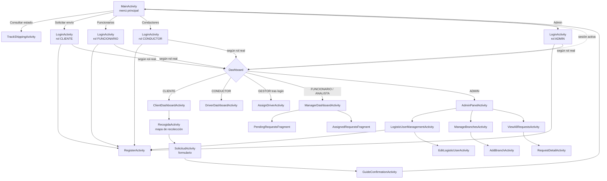

# 3. Pantallas y navegación

Todas las pantallas están declaradas en `AndroidManifest.xml` con `exported="false"`, salvo `MainActivity` (launcher).

## Mapa de navegación

## Catálogo de pantallas

### Acceso y autenticación

| Activity | Descripción | Notas |
|----------|-------------|-------|
| `MainActivity` | Menú de entrada con cinco botones: consultar estado, solicitar envío, funcionarios, conductores, admin. Si hay sesión guardada, redirige al dashboard en `onStart`. | Usa ViewBinding. Constante `EXTRA_TARGET_ROLE` |
| `LoginActivity` | Login por email y contraseña vía `AuthViewModel`. Recibe el rol requerido por el botón pulsado y comprueba que el rol real del usuario sea compatible. Para el rol CLIENTE muestra el enlace de registro. | Ver [Roles y sesión](04-roles-y-sesion.md) |
| `RegisterActivity` | Registro. Un cliente se registra solo como CLIENTE; un admin (extra `EXTRA_IS_ADMIN_REGISTER`) puede elegir CLIENTE, CONDUCTOR, GESTOR, FUNCIONARIO o ANALISTA. Los roles logísticos exigen elegir sucursal (se carga de `GET sucursales`). | Validación de contraseña y email descrita abajo |

**Validaciones de `RegisterActivity`**
- Todos los campos obligatorios llenos.
- Teléfono con al menos 7 caracteres.
- Email con formato válido (`Patterns.EMAIL_ADDRESS`).
- Contraseña: mínimo 8 caracteres, con mayúscula, minúscula y número.
- Las dos contraseñas deben coincidir.
- Sucursal obligatoria para roles logísticos.
- Un email repetido se muestra como error en el campo.

### Cliente

| Activity | Descripción |
|----------|-------------|
| `ClientDashboardActivity` | Saludo con el nombre, botón de nueva solicitud, lista de solicitudes **activas** y **finalizadas**. Acciones por solicitud: cancelar (con diálogo de confirmación) y confirmar entrega. Solo accesible con rol `CLIENTE`; si no, cierra sesión. |
| `RecogidaActivity` | Mapa para elegir la dirección de recolección: GPS, búsqueda por texto (Enter / acción buscar) o toque en el mapa. Devuelve dirección, latitud y longitud a `SolicitudActivity`. |
| `SolicitudActivity` | Formulario de la solicitud: remitente, receptor (tipo y número de documento, teléfono con indicativo), dirección de entrega con mapa, paquete (peso, medidas, contenido) y franja horaria. Muestra un precio estimado. Al guardar busca la sucursal más cercana y crea la solicitud. |
| `GuideConfirmationActivity` | Confirmación tras crear la solicitud. Botones: generar y abrir la guía PDF, "enviar por correo" y volver al inicio. |
| `TrackShippingActivity` | Consulta pública: se escribe el número de guía y se muestra estado, número de guía, dirección, fecha y franja. Maneja 404 y errores de red. |

### Gestión de sucursal (gestor / funcionario / analista)

| Pantalla | Descripción |
|----------|-------------|
| `ManagerDashboardActivity` | `ViewPager2` con dos pestañas (ver abajo). Solo permite `FUNCIONARIO` y `ANALISTA`. |
| `PendingRequestsFragment` | Pestaña 0. Solicitudes `PENDIENTE` de la sucursal; permite asignar un gestor mediante `ManagerDashboardViewModel`. |
| `AssignedRequestsFragment` | Pestaña 1. Solicitudes asignadas de la sucursal para seguimiento. |
| `AssignDriverActivity` | Pantalla del gestor: lista de solicitudes de su sucursal, selección de una, spinner de conductores (`users/conductores/sucursal/{id}`) y botón para asignar. Solo se puede asignar si el estado es `PENDIENTE_ASIGNACION` o `ASIGNADA`. |
| `BranchPendingFragment`, `BranchInRouteFragment`, `BranchCompletedFragment` + `BranchPagerAdapter` | Variante de tres pestañas (pendientes / en ruta / completadas). **No están enlazadas a ninguna pantalla**: `ManagerDashboardActivity` usa `DashboardPagerAdapter`. |

### Conductor

| Activity | Descripción |
|----------|-------------|
| `DriverDashboardActivity` | Lista de rutas del conductor (`solicitudes/driver/{id}/routes`). Cada ítem permite avanzar el estado y abrir la ruta en Google Maps (recolección → entrega). Incluye odómetro GPS configurable (tiempo y distancia) y botón de mapa. Notifica cada cambio de estado. |

Cadena de estados que avanza el conductor:

`ASIGNADA → EN_RUTA_RECOLECCION → EN_DISTRIBUCION → EN_RUTA_REPARTO → ENTREGADA`

### Administración

| Activity | Descripción |
|----------|-------------|
| `AdminPanelActivity` | Contadores por estado (asignadas, en recolección, en distribución, en reparto, entregadas, canceladas) y accesos a las tres gestiones. Solo rol `ADMIN`. |
| `LogisticUserManagementActivity` / `ViewLogisticUsersActivity` | Listado de usuarios logísticos con alta (abre `RegisterActivity` en modo admin), edición y eliminación. Las dos hacen casi lo mismo. |
| `EditLogisticUserActivity` | Edita un usuario logístico: roles `CONDUCTOR`, `FUNCIONARIO`, `GESTOR` y sucursal. Recibe `RECOLECTOR_ID`. |
| `ManageBranchesActivity` | Listado de sucursales con búsqueda, edición y eliminación (usa `ManageBranchesViewModel`). |
| `AddBranchActivity` | Alta y edición de sucursal con selección de ubicación en el mapa (extra `BRANCH_ID` para editar). |
| `ViewAllRequestsActivity` | Lista de todas las solicitudes del sistema. Solo `ADMIN`. |
| `RequestDetailActivity` | Detalle de una solicitud (extra serializable `REQUEST_DATA`) con cambio de estado y asignación de conductor. |

## Extras de `Intent` entre pantallas

| Extra | Origen → destino | Tipo |
|-------|------------------|------|
| `TARGET_ROLE` (`MainActivity.EXTRA_TARGET_ROLE`) | Main → Login | `String` |
| `RECOLECTION_ADDRESS`, `RECOLECTION_LATITUDE`, `RECOLECTION_LONGITUDE` | Recogida → Solicitud | `String`, `Double`, `Double` |
| `solicitudId`, `usuarioEmail` | Solicitud → GuideConfirmation | `Long`, `String` |
| `REQUEST_DATA` | ViewAllRequests → RequestDetail | `SolicitudResponse` (Serializable) |
| `RECOLECTOR_ID` | Gestión de usuarios → EditLogisticUser | `Long` |
| `BRANCH_ID` | ManageBranches → AddBranch | `Int` |
| `EXTRA_IS_ADMIN_REGISTER` / `IS_ADMIN_REGISTERING` | Gestión de usuarios → Register | `Boolean` |

> `ViewLogisticUsersActivity` envía la clave literal `IS_ADMIN_REGISTERING`, pero `RegisterActivity` lee `IS_ADMIN_REGISTER`. Por esa entrada el registro **no** se abre en modo admin (error confirmado en el código). `LogisticUserManagementActivity` sí usa la constante correcta.

## Adapters

| Adapter | Pantalla / uso |
|---------|---------------|
| `SolicitudAdapter` | Lista del cliente (activas y finalizadas) |
| `RequestAdapter` | Lista de solicitudes de admin |
| `AssignedRequestAdapter` | Solicitudes de la sucursal asignadas |
| `DriverRequestAdapter` | Rutas del conductor (implementa `OnRequestClickListener`) |
| `SucursalAdapter` | Listado de sucursales |
| `UserAdapter`, `LogisticUserAdapter` | Listados de usuarios |
| `DashboardPagerAdapter` | Pestañas del panel de gestión |
| `BranchPagerAdapter` (Java) | Pestañas de rama (sin uso) |

## Código sin uso o heredado

- `res/navigation/nav_graph.xml` referencia `FirstFragment` y `SecondFragment`, que no existen: es la plantilla del asistente de Android Studio.
- `res/layout/activity_edit_user.xml` declara el espacio de nombres `res-app` (debería ser `res-auto`).
