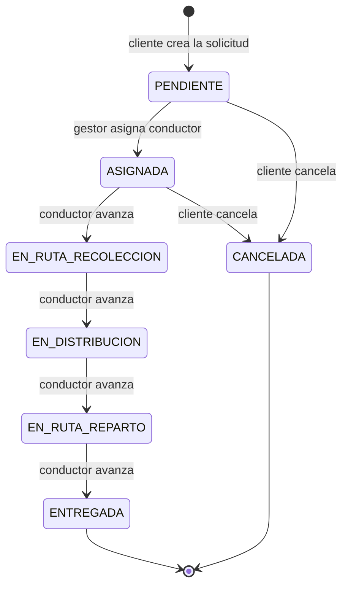

# 5. Flujos de negocio

## Estados de una solicitud

Definidos en el backend (`EstadoSolicitud`). El cliente los maneja como `String`.

| Estado | Significado |
|--------|-------------|
| `PENDIENTE` | Creada, sin asignar |
| `ASIGNADA` | Asignada a un gestor o conductor; aún no inicia la operación |
| `EN_RUTA_RECOLECCION` | El conductor va a recoger el paquete |
| `EN_DISTRIBUCION` | Paquete recogido, en tránsito hacia el centro de distribución |
| `EN_RUTA_REPARTO` | En ruta final hacia el destinatario |
| `ENTREGADA` | Finalizada con éxito |
| `CANCELADA` | Finalizada sin éxito |

**Clasificación en el cliente** (`SolicitudViewModel.isSolicitudActiva`): son finalizadas `ENTREGADA`, `FINALIZADA` y `CANCELADA`; todo lo demás es activa. `FINALIZADA` no existe en el backend (ver [Deuda técnica](11-deuda-tecnica-y-roadmap.md)).

## Flujo 1 — Crear una solicitud (cliente)

1. `MainActivity` → botón *Solicitar envío* → `LoginActivity` (rol CLIENTE). Un usuario nuevo se registra en `RegisterActivity`.
2. `ClientDashboardActivity` → botón de nueva solicitud → `RecogidaActivity`.
3. En `RecogidaActivity` se fija el punto de recolección (GPS, búsqueda o toque en el mapa). Se reverse-geocodifica con `Geocoder` para obtener dirección y ciudad.
4. `SolicitudActivity` recibe dirección y coordenadas. El usuario completa remitente, receptor, dirección de entrega, paquete y franja horaria (`Mañana (8-12)`, `Tarde (12-6)`, `Noche (6-10)`).
5. Se valida el formulario; si pasa, `NewRequestCreationViewModel`:
   1. pide `GET sucursales/cercana?lat&lon` con la ubicación de **recolección**;
   2. copia el `sucursalId` en la petición;
   3. envía `POST solicitudes`.
6. La respuesta incluye la guía (`numeroGuia`, `trackingNumber`). Se abre `GuideConfirmationActivity` con `solicitudId` y el email del usuario.
7. En la confirmación el usuario descarga la guía: `GET solicitudes/{id}/pdf` → se guarda como `guia_solicitud_{id}.pdf` en el directorio externo de la app y se abre con un visor mediante `FileProvider`.

Valores fijos actuales en la creación: `fechaRecoleccion = "2025-01-01"` y precio simulado `5000 + peso × 1500` (solo informativo en pantalla).

## Flujo 2 — Asignar un conductor (gestor)

1. El gestor inicia sesión por la puerta *Conductores*.
2. `AssignDriverActivity` carga las solicitudes de su sucursal (`solicitudes/branch/{id}/assigned`) y los conductores de la sucursal (`users/conductores/sucursal/{id}`).
3. Selecciona una solicitud: solo se puede asignar si está en `PENDIENTE_ASIGNACION` o `ASIGNADA`; en otro caso se avisa de que ya está en curso.
4. Elige un conductor del spinner y confirma: `PUT solicitudes/{id}/assign-driver` con cuerpo `{"recolectorId": "<id>"}`.

Alternativa en el panel de funcionarios: `PendingRequestsFragment` asigna un **gestor** a una solicitud pendiente con `POST solicitudes/{id}/asignar-gestor/{gestorId}`.

## Flujo 3 — Ejecutar la ruta (conductor)

1. `DriverDashboardActivity` carga `GET solicitudes/driver/{driverId}/routes`.
2. En cada ítem, el botón de estado avanza al siguiente estado (`PUT solicitudes/{id}/estado` con `{"estado": "..."}`; el backend responde 204).
3. Tras cada cambio se recarga la lista y se lanza `NotificationService` con el mensaje "Solicitud #N cambió a ESTADO".
4. El botón de mapa abre Google Maps con la ruta recolección → entrega (`maps.google.com/maps?saddr=…&daddr=…`). Si falta una dirección navega solo al punto disponible.
5. El odómetro (`OdometerService`, enlazado como servicio) muestra los metros recorridos cada segundo; los campos de tiempo y distancia reconfiguran la frecuencia del GPS.

## Flujo 4 — Cancelar o confirmar entrega (cliente)

- **Cancelar:** diálogo de confirmación → `PUT solicitudes/{id}/estado` con `CANCELADA`.
- **Confirmar entrega:** envía el estado `FINALIZADA`.
- Al terminar con éxito se recarga la lista.

## Flujo 5 — Rastreo público

1. `MainActivity` → *Consultar estado* → `TrackShippingActivity` (no requiere sesión).
2. El usuario escribe el número de guía y se llama `GET solicitudes/tracking/{trackingNumber}`.
3. Se muestra estado, número de guía, dirección de entrega, fecha de recolección y franja.
4. 404 → "La guía no fue encontrada"; otro error → código HTTP; sin red → mensaje de conexión.

## Flujo 6 — Administración

- **Estadísticas:** `AdminPanelActivity` pide `GET solicitudes` y cuenta por estado en el cliente. `PENDIENTE` no se muestra.
- **Sucursales:** `ManageBranchesActivity` (listar, buscar, eliminar) y `AddBranchActivity` (crear/editar con mapa y geocodificación).
- **Usuarios logísticos:** alta vía `RegisterActivity` en modo admin; edición con `EditLogisticUserActivity`; eliminación con confirmación.
- **Solicitudes:** `ViewAllRequestsActivity` → `RequestDetailActivity` para cambiar estado o asignar conductor.

## Funciones simuladas o incompletas

| Función | Estado |
|---------|--------|
| "Enviar guía por correo" (`GuideConfirmationActivity`) | Solo muestra un aviso y una notificación local; no envía correo |
| Botón "Buscar ID" del receptor | Muestra un `Toast` con el ID escrito |
| Fecha de recolección | Fija en `2025-01-01` |
| Botón de mapa del conductor | Abre navegación a coordenadas fijas (4.632, −74.065) |
| Precio de envío en pantalla | Cálculo local de ejemplo |
